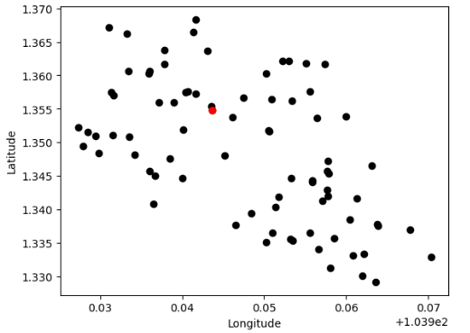
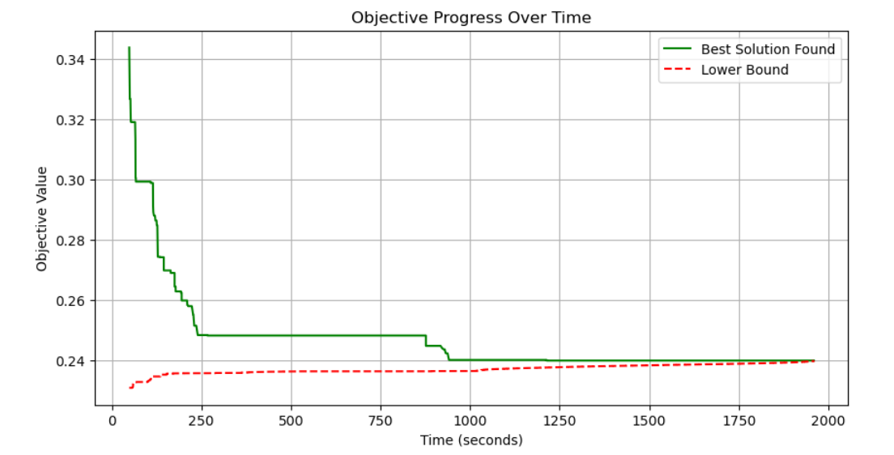
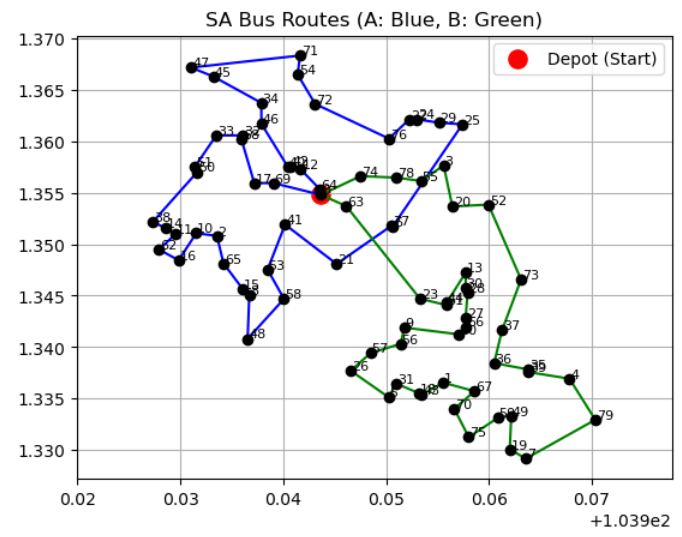
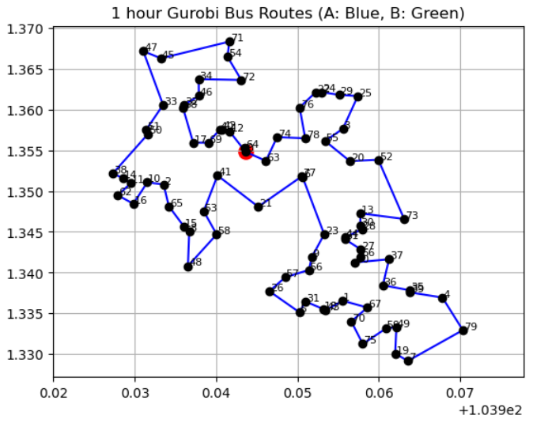

# Bus Stop Optimisation: Tampines Two-Bus Routing

Routing two buses through 80 bus stops in Tampines, Singapore, to minimise total travel distance. An exact Gurobi model is benchmarked against a greedy heuristic, 2-opt, 3-opt and Simulated Annealing, and a passenger-travel penalty is tested as an extension.

SUTD 40.018 Heuristics and Systems Theory group project.

## Problem

Two buses (A and B) start and end at Tampines Interchange (stop 0) and together must cover all 80 stops. The objective is the combined Euclidean distance of both routes.

Stop types are assigned at random with a fixed seed (40% origin, 40% destination, 20% origin-destination), and 200 passenger trips are simulated between them.

## Data

`data/tampines_busstoploc.csv` holds the 80 stops (stop number, LTA bus stop code, description, latitude, longitude), taken from the LTA bus stop dataset. Distances are Euclidean on latitude/longitude, so objective values are in degrees (about 111 km per degree). They are for comparing methods, not road distances.

## Methods

| Method | Notebook | Description |
|---|---|---|
| Gurobi MIP | `01_gurobi_exact_model.ipynb` | Binary arc variables per bus, Miller-Tucker-Zemlin subtour elimination, flow conservation, depot start/end |
| Greedy | `02_metaheuristics.ipynb` | Both buses alternately take the nearest unvisited stop |
| 2-opt, 3-opt | `02_metaheuristics.ipynb` | Local search on each route until no improvement |
| Simulated Annealing | `02_metaheuristics.ipynb` | Starts from the 2-opt route for Bus A and the 3-opt route for Bus B; each step applies 2-opt or 3-opt to one route, then 2-opt to both |
| SA with penalty | `02_metaheuristics.ipynb` | Adds a cost for O-D trips that need more than 3 stops, found by breadth-first search with transfers |

## Results

| Method | Total distance | Gap to Gurobi | Notes |
|---|---|---|---|
| Gurobi | 0.2398 | 0% | Proven optimal (0% gap) in about 1,960 s on a laptop CPU |
| Simulated Annealing | 0.2631 | +9.7% | Bus A serves 41 stops, Bus B serves 40 |
| 2-opt | 0.2747 | +14.6% | Applied to the greedy routes |
| 3-opt | 0.2817 | +17.5% | Applied to the greedy routes |
| Greedy | 0.3096 | +29.1% | Starting solution |

**What the results show**

- Gurobi solved the 80-stop model to proven optimality, but it took about 33 minutes.
- The optimal solution is nearly a single route. Bus A serves 78 stops and Bus B only visits stop 64, next to the depot, because nothing in the model asks for balanced routes.
- Simulated Annealing ends within 10% of that optimum with routes split evenly between the two buses. It found its best solution in the first 3 iterations.
- 2-opt beat 3-opt here, as both started from the same greedy routes.
- The penalty variant ends with a penalised objective of about 2.78, most of which is the penalty term. It cannot create transfers, because its moves only reorder stops inside each route, so the set of stops served by each bus never changes. Passengers can only switch buses at the depot.

## Limitations and next steps

- Demand and stop types are simulated, and distances are straight-line.
- Bus capacity is not modelled.
- The O-D constraint in the Gurobi model only requires each origin to have an outgoing arc and each destination an incoming arc, which already follows from covering every stop. Passenger connectivity is only measured in the penalty experiment.
- The SA starting temperature (100) is far larger than the cost differences (about 0.01), so almost every move is accepted. Scaling the temperature to the cost range is the first thing to tune.
- To make transfers possible, add moves that shift a stop between the two routes or visit an OD stop on both, and score distance and passenger travel together as a multi-objective problem.

## How to run

1. `pip install -r requirements.txt`
2. Gurobi needs a licence (a free academic licence is available at gurobi.com).
3. Run `01_gurobi_exact_model.ipynb`. It sets `model.Params.TimeLimit = 3600`, so lower this for a quick test.
4. Run `02_metaheuristics.ipynb`. The penalty section is slow, because it searches paths for every O-D pair at each iteration.

Both notebooks use `random.seed(1)`, so they generate the same stop types and trips.

## Team

Group project completed with two classmates.

**My role:** [one sentence on what you built]
